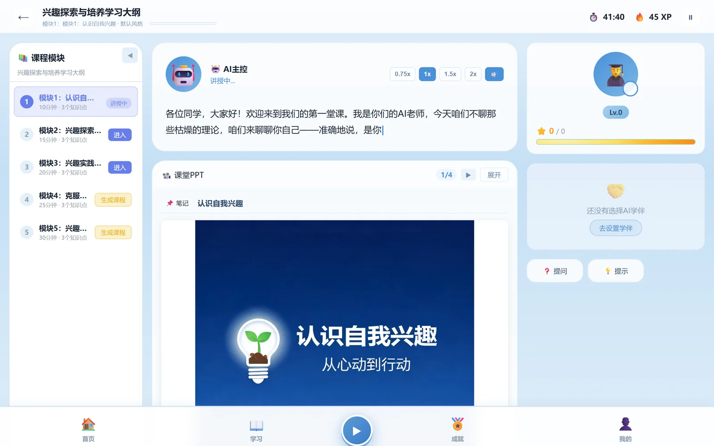
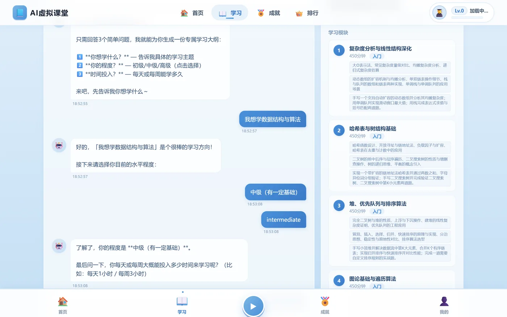
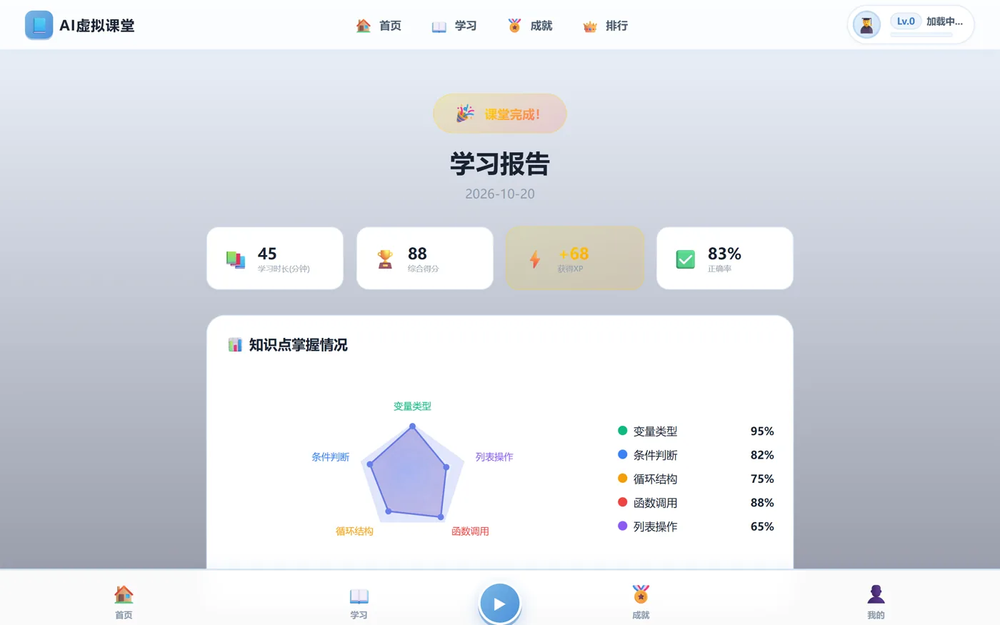

# AI 虚拟课堂 · VirtualClassroom

选一个主题，它给你排一份大纲，然后把这节课讲给你听 —— 讲稿逐字流出、板书一张张生成、讲完出题判卷，最后给一份学习报告。

> 本地运行的项目，**没有部署线上**。需求、技术选型、关键实现和踩过的坑整理在
> [博客作品页的项目档案](https://blue-riband-x.github.io/personal-blog/works) 里。



## 功能

- **对话式生成大纲**：用三个问题（主题、当前水平、每天能投入多久）换一份可增删改的大纲，
  不是拉一个通用课程列表，而是按你的时间预算排。
- **流式讲课**：AI 教师按选定风格逐字讲，讲稿和板书同步推进；支持中途提问、快进到下一个知识点。
- **教师风格**：幽默 / 严谨 / 默认三套提示词，同一份大纲换风格就是另一种节奏。
- **AI 板书**：每个模块配一张板书图，模型生成，和课程绑定后跟着讲稿翻页。
- **判卷与报告**：四维评分折算成知识点掌握度，雷达图直接看短板。
- **学伴**：课堂侧的伴读角色，随时插话补充背景知识。
- **游戏化**：XP、等级、连续学习天数、排行榜。
- **3D 形象**：Three.js 渲染的虚拟教师，空闲时每 4 秒眨一次眼。

| 大纲 | 报告 |
| --- | --- |
|  |  |

## 架构

三个服务各管一摊，前端只认一个域名，靠 devServer 的代理规则分发：

```
浏览器 (Vue 3, :8080)
   ├─ /api/v1/auth      ─┐
   ├─ /api/v1/users      ├→ Spring Boot (:8081)  账号 / 用户 / 大纲 CRUD / 排行榜
   ├─ /api/v1/leaderboard┘
   └─ /api/v1/outline/*、/api/ai/*  → FastAPI (:8000)  教学 Agent、流式讲稿、板书生成
                                          ├→ MySQL 8     11 张业务表
                                          └→ Chroma      历史对话向量索引
```

- **Java 侧**只做高并发的常规业务：注册登录（JWT + 拦截器）、用户资料、大纲的增删改查、排行榜。
- **Python 侧**只做模型相关的部分：LangGraph 编排的教学 Agent、SSE 流式输出、板书生成。
- 两边读同一个 MySQL 库，表由 Python 侧启动时 `Base.metadata.create_all` 建好。

## 目录结构

```
frontend/          Vue 3 + Vue CLI 5 + Pinia + vue-router + ECharts + Three.js
  src/views/       Login / Home / Plan / Classroom / Report / Leaderboard / Game / Profile
  src/components/  ThreeAvatar（3D 形象）、布局、通用组件
  vue.config.js    devServer 代理规则（哪些接口给 Java、哪些给 Python）
java-backend/
  java-backend/    Spring Boot 4 / Java 17 / MyBatis
backend/           FastAPI + LangGraph
  app/langgraph/   outline_agent / tutor_agent / board_agent / orchestrator
  app/sse/         连接管理与事件推送
  app/models/      SQLAlchemy 模型
  static/boards/   板书生成目录（运行时产物，不进版本库）
docs/              架构设计与答辩材料
```

## 快速开始

前置：**JDK 17**、**Node 18+**、**Python 3.11+**、**MySQL 8**，以及模型服务的 Key
（DeepSeek 负责文本、阿里百炼 `embedding-v4` 负责向量、豆包 Seedream 负责板书配图）。

```bash
# 1. 建库
mysql -uroot -p -e "CREATE DATABASE virtual_classroom DEFAULT CHARSET utf8mb4;"

# 2. Python AI 后端（:8000）
cd backend
python -m venv .venv && . .venv/bin/activate      # Windows: .venv\Scripts\activate
pip install -r requirements.txt
cp .env.example .env                              # 填 DASHSCOPE_API_KEY / DEEPSEEK_API_KEY / 豆包相关
uvicorn main:app --host 127.0.0.1 --port 8000

# 3. Java 主后端（:8081）
cd java-backend/java-backend
cp src/main/resources/application-local.example.properties src/main/resources/application-local.properties
# 打开 application-local.properties 填数据库账号（该文件不进版本库，也可以用 DB_USERNAME / DB_PASSWORD 环境变量）
mvn spring-boot:run

# 4. 前端（:8080）
cd frontend
npm install
npm run serve
```

三端起来后打开 http://localhost:8080 注册即可。第一次启动时 Python 侧会自动建表。

> 没有模型 Key 时大纲生成会失败，课堂进不去。板书图是运行时生成到 `backend/static/boards/` 的，
> 属于产物，不进版本库。

## 环境变量

`backend/.env.example` 是完整清单，实际只需要填几项：

| 变量 | 用途 |
| --- | --- |
| `DATABASE_URL` | 数据库连接，默认 SQLite，生产用 `mysql+aiomysql://...` |
| `DASHSCOPE_API_KEY` | 阿里百炼，用于 `embedding-v4` 生成向量 |
| `DEEPSEEK_API_KEY` | 讲稿、大纲、判卷的文本生成 |
| `SECRET_KEY` | 签发 JWT 的密钥 |
| `DB_URL` / `DB_USERNAME` / `DB_PASSWORD` | Java 侧的 MySQL 连接，不设则用 `127.0.0.1:3306/virtual_classroom` 与本地配置文件里的账号 |

根目录 `.env`、`backend/.env`、`.mcp.json`、数据库文件和 `model_3D/` 都在 `.gitignore` 里，不进版本库。

## 已知问题

- **语音与文字的节奏还没对齐**：目标是「文字等语音、由语音带节奏」，目前以文字流式为主，
  语音合成的排队逻辑还在改。
- 大纲生成依赖模型返回的 JSON 结构，格式不对时需要重试一次。
- 排行榜是每次请求直接查库（`findTopByXp` 取前 20），没有缓存。

## 相关

- 项目档案（需求 / 选型 / 实现 / 踩坑）：https://blue-riband-x.github.io/personal-blog/works
- 架构设计：[docs/backend-architecture-design.md](docs/backend-architecture-design.md)
- 答辩材料：[docs/defense-preparation.md](docs/defense-preparation.md)
